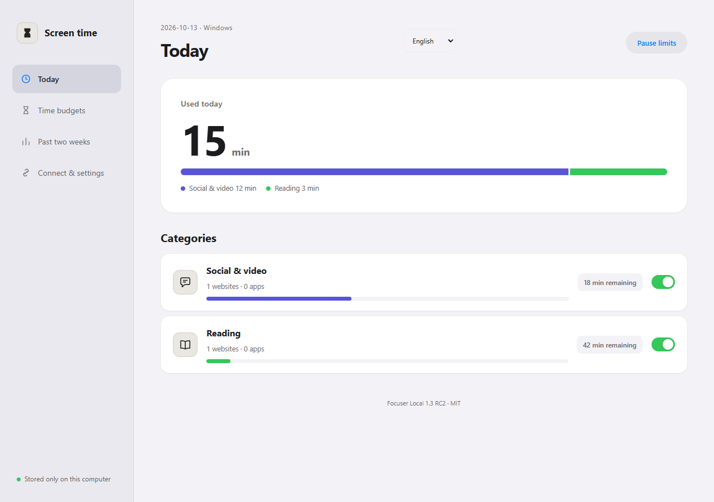

<div align="center">

# Focuser

### Spend your attention on purpose.

**Free, open-source screen-time budgets. Local by default. Yours to control.**

[](https://github.com/intKay/Focuser/actions/workflows/check.yml)
[](LICENSE)
[](https://www.python.org/downloads/)

**English** · [简体中文](README.zh-CN.md)

[Download v1.3.0-rc.2](https://github.com/intKay/Focuser/releases/tag/v1.3.0-rc.2) · [Installation](docs/release/quickstart.en.md) · [Privacy](SECURITY.md) · [Contribute](CONTRIBUTING.md)

</div>

Focuser helps you stop opening websites and apps on autopilot. Set a shared daily budget, write an intention before you begin, and let the limit mark a stopping point. Manage everything in a local browser dashboard; the service can start quietly when you log in.

**No account. No subscription. No trial timer. No cloud backend.** Your intention text is never saved or uploaded. Focuser stores only the rules and category-level state needed to enforce your budgets.



## What you get

| Feature | How it helps |
| --- | --- |
| **One budget across browsers** | Websites in the same category share a daily allowance. Switching browsers does not reset it. Windows apps can share that allowance too. |
| **An intention before a session** | A private prompt asks what you came to do. Nothing is charged before confirmation. |
| **Weekday budgets and downtime** | Set different allowances for each day and up to six blocked periods, including overnight hours. |
| **A pause before relaxing limits** | Increasing time, removing restrictions, pausing or quitting requires a one-action integral challenge. One extra minute is available once per day across all categories. |
| **A local view of your time** | See two weeks of category totals, without saved page titles, visited URLs or intention text. |
| **English and 简体中文** | The dashboard and extension follow your language and offer a manual selector. Windows native prompts follow the system language; `--lang en` / `--lang zh` overrides it. |

## Get started

**Requires Python 3.10+.** Download and extract `focuser-local-1.3.0rc2-source.zip` from the [release](https://github.com/intKay/Focuser/releases/tag/v1.3.0-rc.2). Keep the extracted folder in a permanent location.

**1. Install and start** — run from that folder, as a normal user:

| System | First-time installation |
| --- | --- |
| Windows | `python install.py --new-install` |
| Fedora / Linux / macOS | `python3 install.py --new-install` |

The installer creates an isolated Python environment, installs Focuser, configures user-login startup, and opens the dashboard. Fedora needs `sudo dnf install python3 python3-pip` first. Do not run the installer itself as root. Dependency installation may use the internet; daily operation stays local.

**Upgrading or moving from another system?** Retain your complete private data directory and use `python3 install.py --data-dir /path/to/existing-data` (Windows: `python`). **Do not use `--new-install` for migration.** See [Fedora migration](docs/release/fedora.md) and [installation details](docs/release/quickstart.en.md).

**2. Connect your browser** — in the dashboard, open **Connect & settings**, download the extension and extract it to a permanent folder. In Chrome/Edge/Brave/Opera/Vivaldi, open the extension manager, enable **Developer mode**, and choose **Load unpacked**. Repeat in each browser, connecting to the same local service.

**3. Make it yours** — open [127.0.0.1:18765](http://127.0.0.1:18765/), choose your language, and edit categories in **Time budgets**. The initial example blocks Douyin and gives social/video sites a shared 30-minute budget.

> Firefox uses a separate **unsigned test extension** loaded through `about:debugging`. Restarting Firefox removes that temporary installation. Chromium is the simpler choice for persistent limits in this release.

## Platform support

| Platform | Browser limits | Native app limits | Login startup |
| --- | --- | --- | --- |
| Windows 10/11 | Yes | Yes, with desktop dependencies | Hidden user startup entry |
| Fedora / other Linux | Yes, including Wayland sessions | Not implemented | systemd user service |
| macOS | Yes | Not implemented | launchd agent |
| Android / iOS / Safari | Not supported | Not supported | — |

**v1.3.0-rc.2 is a prerelease.** Automated checks cover Windows, macOS, Ubuntu and a Fedora container. These are not a substitute for real desktop/browser acceptance. See [compatibility](docs/release/compatibility.md).

Budgets are shared within one local service and data directory, not automatically across devices or operating systems. A migration containing unsupported native app rules is refused rather than silently weakening them.

## Privacy and control

The backend binds only to `127.0.0.1`. No telemetry, accounts, cookies permission or remote analytics. Rules, recent category totals, bonus claims and pause state stay on your machine; extension connection and language preferences stay in your browser. The intention prompt is isolated from the target website.

Focuser is a self-discipline tool, not an administrator-proof security boundary. A local administrator can stop it, uninstall extensions or alter local files. Read the [security and privacy model](SECURITY.md).

## For contributors and agents

Current source development adds [encrypted configuration import/export](docs/release/config-transfer.md). This feature is not included in the existing v1.3.0-rc.2 release assets.

The runtime is standard-library Python plus vanilla JavaScript. Windows desktop dependencies are optional. Start with [architecture and API v1](docs/release/architecture.md) and [contribution rules](CONTRIBUTING.md).

```sh
python -m unittest discover -s tests -p "test_*.py"
node tests/test_screen_time_extension.cjs
```

`scripts/` contains the budget core, HTTP API, platform adapters and installers. `resources/screen_time/` contains the dashboard and extensions. `outputs/` is private local state and build evidence, never a public source directory. Use isolated data and ports for testing; preserve consumed time and the verification gate during every upgrade.

[Changelog](CHANGELOG.md) · [Release checklist](docs/release/checklist.md) · [Report an issue](https://github.com/intKay/Focuser/issues) · [MIT license](LICENSE)
