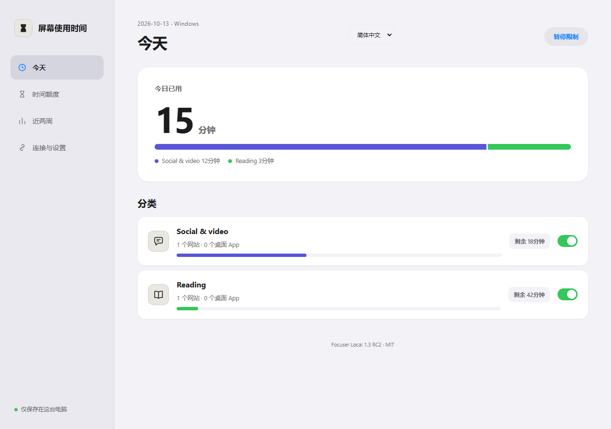

<div align="center">

# Focuser

### 把注意力留给真正想做的事。

**免费开源的屏幕时间工具。本地运行，由你掌控。**

[](https://github.com/intKay/Focuser/actions/workflows/check.yml)
[](LICENSE)
[](https://www.python.org/downloads/)

[English](README.md) · **简体中文**

[下载 v1.3.0-rc.2](https://github.com/intKay/Focuser/releases/tag/v1.3.0-rc.2) · [安装指南](docs/release/quickstart.zh-CN.md) · [隐私](SECURITY.md) · [参与贡献](CONTRIBUTING.md)

</div>

Focuser 帮你减少无意识地打开网站和 App。设定共享的每日额度，开始前写下用途，让限额成为停下来的提醒。主要操作都在本机网页完成，服务可以在登录后静默运行。

**无需账号、订阅或试用，没有云端后端。** 用途文字不保存、不上传；只在本机保留执行额度所需的规则与分类状态。



## 你能用它做什么

| 功能 | 带来的帮助 |
| --- | --- |
| **多个浏览器共用额度** | 同一类别的网站共享每日时间，切换浏览器不会刷新余额。Windows App 也可绑定到同一额度。 |
| **使用前确认用途** | 私人提示让你先想清楚要做什么；确认前不开始计时。 |
| **按星期额度与停用时段** | 每天可以有不同额度，最多设置六段停用时间，支持跨午夜。 |
| **放宽前停下来思考** | 增加时间、移除限制、暂停或退出，需要完成与单次操作绑定的定积分验证。每天所有分类合计可领一次额外一分钟。 |
| **本地查看分类用时** | 查看近两周分类总时长，不保存页面标题、访问 URL 或用途文字。 |
| **中文与英文界面** | 控制台及扩展自动选择语言，也可手动切换。Windows 原生提示跟随系统语言，可用 `--lang en` / `--lang zh` 指定。 |

## 开始使用

**需要 Python 3.10+。** 从 [Release](https://github.com/intKay/Focuser/releases/tag/v1.3.0-rc.2) 下载并解压 `focuser-local-1.3.0rc2-source.zip`，将文件夹放在长期保留的位置。

**1. 安装并启动**——在解压目录，用普通用户运行：

| 系统 | 首次安装命令 |
| --- | --- |
| Windows | `python install.py --new-install` |
| Fedora / Linux / macOS | `python3 install.py --new-install` |

安装器自动创建独立 Python 环境、安装 Focuser、配置登录启动并打开控制页。Fedora 先运行 `sudo dnf install python3 python3-pip`。安装器本身不要用 root 运行。下载依赖可能联网，日常运行保持本地。

**升级或从另一系统迁移？** 保留完整私人数据目录，使用 `python3 install.py --data-dir /原数据目录`（Windows 用 `python`）。**迁移不要加 `--new-install`。** 详见 [Fedora 迁移](docs/release/fedora.md) 与 [安装细节](docs/release/quickstart.zh-CN.md)。

**2. 连接浏览器**——在控制页打开“连接与设置”，下载扩展并解压到固定位置。Chrome/Edge/Brave/Opera/Vivaldi 的扩展管理页中开启“开发者模式”，点击“加载已解压的扩展程序”。每个浏览器都需要安装，连接同一个本机服务。

**3. 按自己的需要设置**——打开 [127.0.0.1:18765](http://127.0.0.1:18765/)，选择语言，在“时间额度”里编辑分类。初始示例封印抖音，社区与视频网站共享每日 30 分钟。

> Firefox 使用独立的**未签名测试扩展**，在 `about:debugging` 临时加载；浏览器重启后会移除。本版本长期使用建议先选 Chromium 系列。

## 平台支持

| 平台 | 网站限制 | 原生桌面 App 限制 | 登录启动 |
| --- | --- | --- | --- |
| Windows 10/11 | 支持 | 支持，需桌面依赖 | 隐藏启动入口 |
| Fedora / 其他 Linux | 支持，包括 Wayland 会话 | 尚未实现 | systemd 用户服务 |
| macOS | 支持 | 尚未实现 | launchd agent |
| Android / iOS / Safari | 未支持 | 未支持 | — |

**v1.3.0-rc.2 是预发布候选版。** 自动检查覆盖 Windows、macOS、Ubuntu 和 Fedora 容器，不能替代真实桌面及浏览器验收。见 [兼容性说明](docs/release/compatibility.md)。

额度共享范围是同一本机服务与数据目录，不会自动跨设备或操作系统同步。迁移时若含不支持的原生 App 规则，程序会拒绝启动，避免静默放宽限制。

## 隐私与控制

后端仅监听 `127.0.0.1`。没有遥测、账号、cookies 权限或远端分析。规则、分类用时、额外分钟记录和暂停状态保存在本机，连接与语言偏好保存在浏览器中。用途输入与目标网站隔离。

Focuser 是自律工具；本机管理员仍可停服、卸载扩展或改动本地文件。完整边界见 [安全与隐私说明](SECURITY.md)。

## 给开发者与 Agent

当前源码新增[配置导入/导出](docs/release/config-transfer.md)，尚未包含在既有 v1.3.0-rc.2 Release 包中。

基础服务使用 Python 标准库，界面使用原生 JavaScript；Windows 桌面依赖可选。先阅读 [架构与 API v1](docs/release/architecture.md)、[贡献规则](CONTRIBUTING.md)。

```sh
python -m unittest discover -s tests -p "test_*.py"
node tests/test_screen_time_extension.cjs
```

`scripts/` 是额度核心、HTTP API、平台适配器和安装器；`resources/screen_time/` 是控制台与扩展；`outputs/` 是私人数据与本地构建证据，不公开提交。测试使用隔离数据与端口，每次升级都保留已消耗额度及验证门槛。

[变更记录](CHANGELOG.md) · [发布清单](docs/release/checklist.md) · [反馈问题](https://github.com/intKay/Focuser/issues) · [MIT License](LICENSE)
