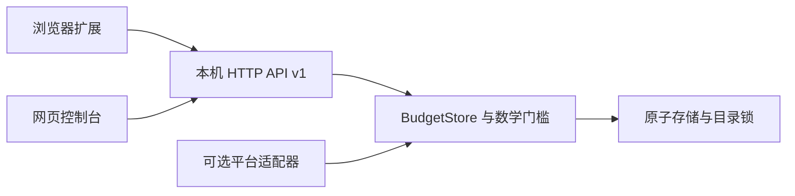

# 架构与扩展协议

`screen_time_core.py` 管理额度、跨客户端去重、前台租约、每日结算、用途批准和历史；不导入桌面 API。`screen_time_challenge.py` 管理操作与参数绑定的单次验证。不得增加未验证的配额管理接口。

`screen_time_server.py` 负责 loopback HTTP、输入大小/类型、Host/Origin 验证和网页资源。`screen_time_platform.py` 是能力边界，Windows 原实现延迟加载；macOS/Linux 使用仅浏览器适配器。网页根据 capabilities 显示实际桌面能力，不用操作系统名字推断支持。

`screen_time_runtime.py` 管理平台默认数据目录、版本与内核单写入锁。`screen_time_storage.py` fsync 临时文件后原子替换。保存失败的规则、暂停、bonus 操作回滚内存；计时保存错误不会自动归零。

`screen_time_release.py` 按白名单产生可重复的源码/扩展包，Firefox 使用独立 manifest；`screen_time_startup.py` 只生成按平台选择的登录启动模板。pip wheel 包含服务模块与资源，运行数据独立于安装目录。

## API v1

| 路由 | 方法 | 用途 |
| --- | --- | --- |
| `/api/health` | GET | 服务/version/API版本、目录标识、平台能力、App错误；不消费时间 |
| `/api/status` | GET | 当前分类、剩余额度、汇总历史、连接状态 |
| `/api/apps` | GET | 当前平台可配置的运行程序及 supported 标识 |
| `/api/heartbeat` | POST | client/group/active/browser；前台租约与用途检查 |
| `/api/intent` | POST | 临时确认具体用途；不保存文字 |
| `/api/bonus` | POST | 按既有规则领取当天全局唯一额外分钟 |
| `/api/config` | POST | 替换分类；任何放宽先校验单次令牌 |
| `/api/pause`、`/api/quit` | POST | 暂停或退出先验证；恢复限制无需验证 |
| `/api/challenge`、`/api/verify` | POST | 签发题目、独立提交验算；不返回答案 |
| `/extensions/{chromium,firefox}.zip` | GET | 内存生成本地安装包，不含私人数据 |

409表示扩展绑定的 instance_id 与当前目录不同，未执行操作；428表示需要数学验证；503表示持久化失败。POST JSON最大64KiB、连接读取超时5秒。扩展发送 instance_id，服务在任何写操作前验证；首次连接需 /api/health 握手。旧扩展无该字段时保持兼容。

网页来自精确 loopback Origin；Chromium扩展 ID、Firefox UUID 使用严格格式。控制 API 不接受任意网站 Origin。新增客户端不得通过目标网站窗口转发用途、令牌或敏感输入。

## 扩展新功能

新平台：实现 `capabilities`、`desktop_unlocked`、`available_apps`、`open_panel`；若支持原生拦截，提供 `monitor(store, stop)`。只匹配用户明确选定的程序，保留系统与浏览器保护；请求用途后才发活动租约，与浏览器共用 BudgetStore。增加系统专属测试与实机验收，再将 native_apps 标为true。

新浏览器：保持同一个核心 background/content/intent 模块，只在构建时转换 manifest 与 API兼容层。不得各浏览器独立持久化剩余额度。DNR生效失败、服务离线、绑定变化需要保持拦截并显示错误。

新规则：使用稳定分类ID。删除旧分类、改ID、移除域名/App、关闭或增加额度均沿用 relaxation 检查。不能新增“导入配置”“恢复默认”“调试重置”等未验证的放宽路径。

版本策略：破坏性API变更提高 api_version；state格式升级必须备份、原子迁移并有保留history/bonus的回归；不因安装目录、平台或版本变化发放新额度。
